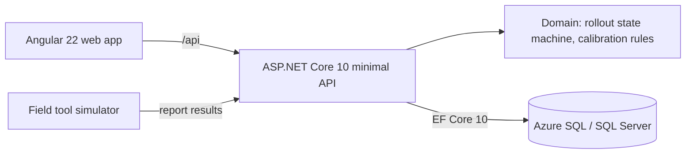

# ToolFleet

Track downhole tools across field bases and roll out firmware in stages: a small canary group first, an automatic halt if too many fail, and a human sign-off before the rest of the fleet updates. Every change lands in an audit log.

<!-- Replace with a GIF of the demo story once the UI exists (week 4). -->


[Live demo](#) · [MVP scope](docs/mvp-scope.md)
<!-- CI badge: Azure DevOps > Pipelines > ... > Status badge, paste the Markdown here. -->

## Architecture



```
Draft ─start─▶ Canary ─pass─▶ AwaitingPromotion ─promote─▶ Full ─pass─▶ Completed
                 └── failures above threshold ──▶ Halted ◀──┘
```

| Folder | What's in it |
| --- | --- |
| `src/ToolFleet.Domain` | Entities and business rules. Plain C#, no framework dependencies. |
| `src/ToolFleet.Api` | Minimal API endpoints, EF Core `DbContext`, audit logging, dev seed data |
| `tests/ToolFleet.Domain.Tests` | xUnit tests for the rollout state machine and calibration rules |
| `tests/ToolFleet.Api.Tests` | HTTP tests through `WebApplicationFactory` on in-memory SQLite |
| `web` | Angular frontend |
| `tools/simulator.cs` | Pretends to be field tools reporting update results |
| `azure-pipelines.yml` | CI: build, test, coverage, artifacts |

## Run it locally

You need the [.NET 10 SDK](https://dotnet.microsoft.com/download), Node 24 and Docker.

```bash
# one-time setup
dotnet tool install --global dotnet-ef
docker compose up -d                    # SQL Server on localhost:1433

# build and test
dotnet build
dotnet test

# create the database schema (first time, and after every model change)
dotnet ef migrations add InitialCreate --project src/ToolFleet.Api --output-dir Data/Migrations

# run the API on http://localhost:5080 (applies migrations and seeds 40 demo tools)
dotnet run --project src/ToolFleet.Api

# in a second terminal: the web app on http://localhost:4200
cd web && npm install && npm start
```

No Docker? Run the API with SQLite instead: `dotnet run --project src/ToolFleet.Api --launch-profile sqlite`.

The OpenAPI description is at `http://localhost:5080/openapi/v1.json` in development.

### Try a rollout from the terminal

```bash
# publish firmware 4.2.0 for the MWD Pulser model
curl -s -X POST localhost:5080/api/firmware -H "Content-Type: application/json" \
  -d '{"model":"MWD Pulser","version":"4.2.0","notes":"Fixes pulse timing drift"}'

# create a rollout with the release id from above: 10% canary, halt above 20% failures
curl -s -X POST localhost:5080/api/rollouts -H "Content-Type: application/json" \
  -d '{"firmwareReleaseId":"<release-id>","canaryPercent":10,"failureThresholdPercent":20}'

# let the simulator start it and report results for the canary tools
dotnet run tools/simulator.cs -- <rollout-id> --fail-rate 0.1

# if the canary passed, promote and run the simulator again for the rest
curl -s -X POST localhost:5080/api/rollouts/<rollout-id>/promote
dotnet run tools/simulator.cs -- <rollout-id>

# see what happened
curl -s "localhost:5080/api/audit?entityType=Rollout"
```

## Design decisions

- The domain owns the rules. `Rollout` exposes `Start`, `RecordResult`, `Promote` and `Abort`; nothing else can change its state. The endpoints load, call one method and save. That is why the state machine can be tested without a database.
- Randomness stays out of the domain. The API shuffles the tools and the domain takes the first N as the canary, so tests are deterministic.
- Promotion is manual. A canary that passes waits for a person. Automatic promotion is easy to add, but a wrong firmware image on 800 tools in the field is expensive.
- Audit rows are written in the same transaction as the change, by overriding `SaveChangesAsync`, so the log can't miss a change or record one that rolled back.
- Business-rule violations return 422 with an RFC 9457 problem-details body.

## What I'd do next

- Microsoft Entra ID login, with separate engineer and approver roles
- Optimistic concurrency (`rowversion`) so two approvers can't promote at the same time
- Roll back to `PreviousVersion` automatically when a rollout halts
- Teams notification when a rollout halts
- Generate the TypeScript API types from the OpenAPI document
